  

**Estudiante de Ingeniería Informática en la Universidad Veracruzana**

---

## MI STACK

### Bases de datos

### Lenguajes

### Frontend

### Sistemas

---

## LENGUAJES

---

## 🚀 PROYECTOS DESTACADOS

- **Base de datos sismológica**: PostgreSQL (JSONB), ETL en Python y backend en Java.
- *(agrega aquí otros proyectos con su enlace)*

---

## 🤝 ¡CONECTEMOS!

